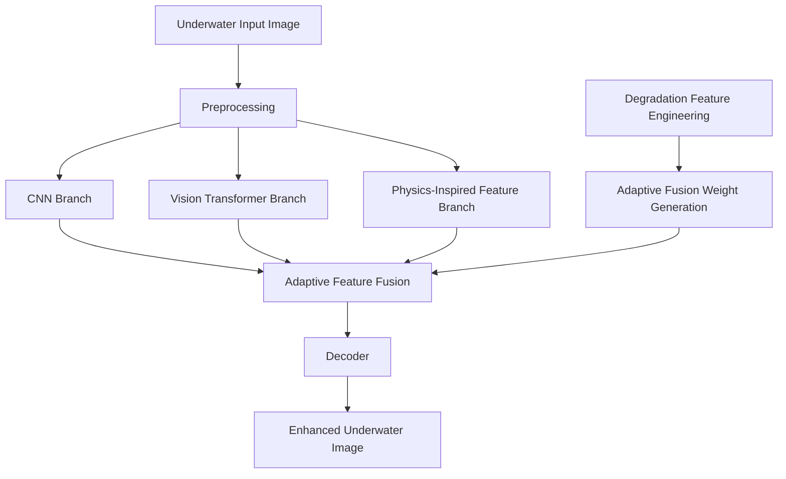
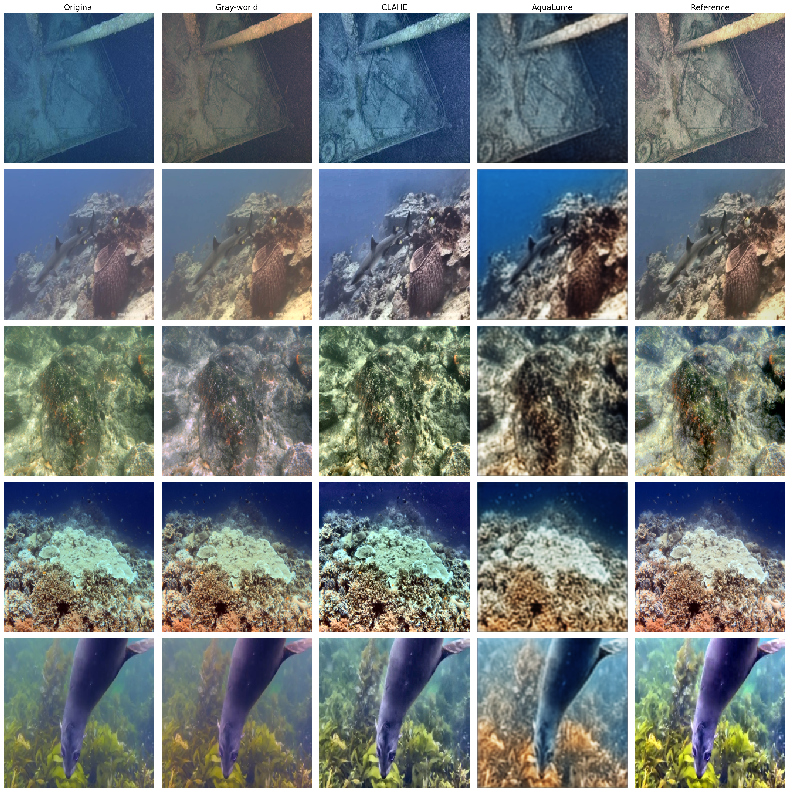
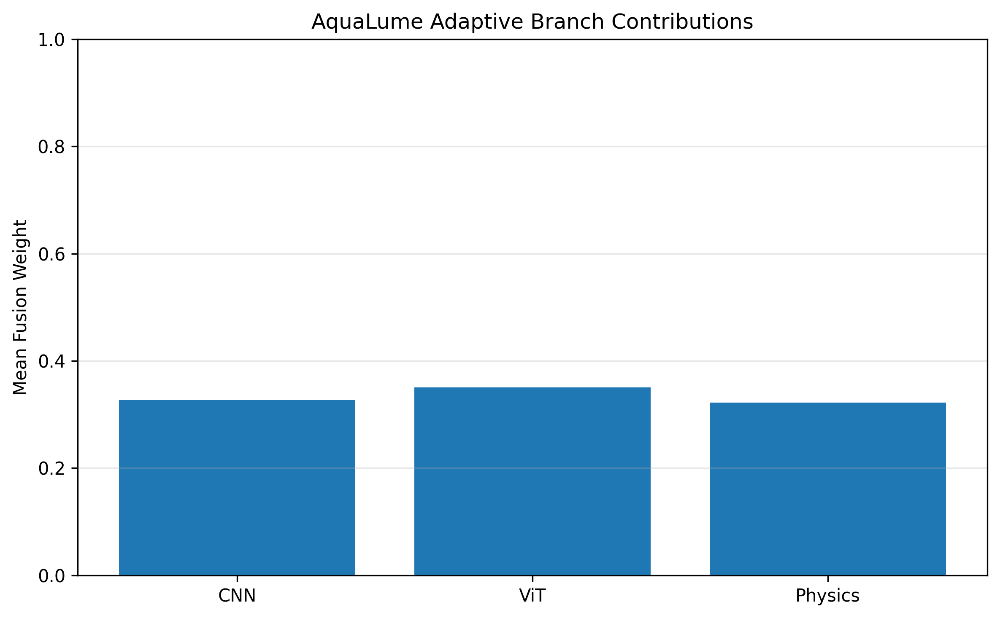
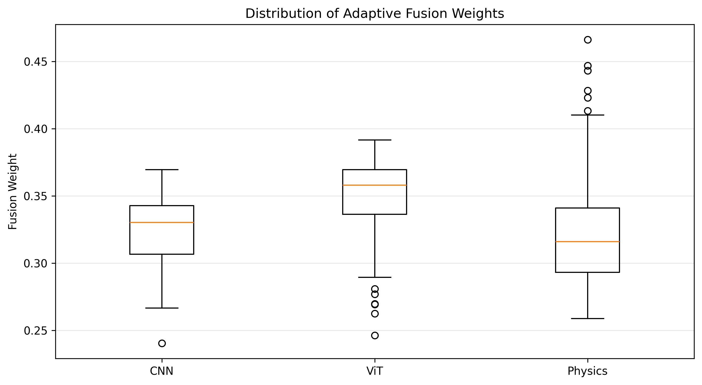

# Physics-Guided Vision Transformer Framework for Underwater Image Enhancement

A hybrid deep learning framework for underwater image enhancement integrating convolutional feature extraction, Vision Transformer-based contextual representation, physics-inspired degradation features, and adaptive feature fusion.

---

## Abstract

Underwater images frequently suffer from color distortion, low contrast, reduced visibility, and loss of structural details due to wavelength-dependent light absorption and scattering. These degradation effects make underwater image enhancement a challenging computer vision problem.

This project presents a **Physics-Guided Vision Transformer Framework for Underwater Image Enhancement**, a hybrid architecture designed to integrate complementary visual representations through adaptive feature fusion. The framework combines a Convolutional Neural Network (CNN) branch for local feature extraction, a Vision Transformer (ViT) branch for contextual representation, and a physics-inspired branch incorporating image degradation characteristics.

An adaptive fusion mechanism integrates the representations from these branches before image reconstruction through a decoder. In addition, degradation-aware feature engineering incorporates image-level characteristics such as RGB channel imbalance, grayscale contrast, and Laplacian-based sharpness.

The framework was evaluated on a paired subset of the Underwater Image Enhancement Benchmark (UIEB), with comparisons against conventional enhancement techniques. Experimental results demonstrate improved PSNR and error-based metrics over the evaluated baselines, while the results also highlight trade-offs between quantitative metrics and perceptual image quality.

---

## Key Contributions

- **Hybrid CNN–ViT architecture:** Integrates local feature extraction and global contextual representation within a unified enhancement framework.
- **Physics-inspired degradation representation:** Incorporates image-level degradation characteristics to inform enhancement.
- **Adaptive feature fusion:** Combines CNN, ViT, and physics-inspired representations through learned fusion weights.
- **Degradation-aware feature engineering:** Uses RGB channel-mean imbalance, grayscale contrast, and Laplacian variance.
- **Leakage-aware dataset preparation:** Conducts duplicate-scene inspection and excludes identified cross-split duplicates.
- **Comparative evaluation:** Evaluates the proposed framework against Original, CLAHE, and GrayWorld using PSNR, SSIM, MAE, and RMSE.
- **Diagnostic branch analysis:** Investigates the visual effects of selectively disabling individual branches during inference.
- **CPU inference benchmarking:** Reports model parameter count, checkpoint size, and measured inference time.

---

## Architecture

The proposed framework processes an underwater image through parallel feature-extraction branches, followed by degradation-aware adaptive fusion and image reconstruction.



### Architectural Components

| Component | Function |
|---|---|
| CNN Branch | Extracts local spatial features and visual details |
| Vision Transformer Branch | Captures contextual representations |
| Physics-Inspired Branch | Incorporates degradation-related representation |
| Degradation Feature Engineering | Computes image-level characteristics |
| Adaptive Fusion | Integrates branch representations using adaptive weights |
| Decoder | Reconstructs the enhanced image |

### 1. CNN Branch

The CNN branch extracts local spatial features from the underwater input image. Convolutional feature extraction supports the representation of spatial structures, local patterns, and image details.

### 2. Vision Transformer Branch

The Vision Transformer branch captures contextual representations of the image. Its role within the hybrid architecture is to complement local convolutional representations with broader contextual information.

### 3. Physics-Inspired Branch

The physics-inspired branch incorporates degradation-related image characteristics into the feature representation. This component is intended to provide information associated with underwater image degradation and support the adaptive enhancement process.

### 4. Adaptive Feature Fusion

The adaptive fusion mechanism combines the representations produced by the CNN, ViT, and physics-inspired branches.

The fusion weights are generated using degradation-related information, allowing the framework to combine branch representations instead of relying exclusively on a fixed feature-combination strategy.

### 5. Decoder

The decoder reconstructs the enhanced image from the fused representation.

---

## Degradation-Aware Feature Engineering

The framework incorporates image-level degradation characteristics as additional information for adaptive fusion.

The implemented degradation-related features include:

| Feature | Description |
|---|---|
| RGB Channel-Mean Imbalance | Captures differences in average intensity among RGB channels |
| Grayscale Contrast | Represents grayscale intensity variation |
| Laplacian Variance | Captures sharpness-related information associated with image detail |

The extracted features are normalized using a scaler fitted on the training data.

These features provide degradation-related information to the adaptive fusion mechanism.

---

## Dataset

### Underwater Image Enhancement Benchmark (UIEB)

The framework was developed and evaluated using the paired subset of the UIEB dataset.

UIEB provides underwater images alongside corresponding reference images for underwater image enhancement research.

### Dataset Split

| Dataset | Images |
|---|---:|
| Training | 623 |
| Validation | 132 |
| Testing | 133 |
| **Total** | **888** |

### Dataset Integrity and Duplicate-Scene Inspection

A duplicate-scene inspection was conducted across the dataset splits to identify potential data leakage.

Two duplicate-scene instances were identified across the splits and excluded from the finalized dataset configuration:

- `648_img_.png` — validation copy of `582_img_.png` in the training split.
- `708_img_.png` — test copy of `829_img_.png` in the training split.

The finalized split was used for the reported training and evaluation experiments.

### Dataset Source

**UIEB — Underwater Image Enhancement Benchmark**

Dataset access and usage are subject to the original dataset terms.

---

## Experimental Methodology

The experimental pipeline consisted of the following stages:

1. **Dataset inspection and preparation:** Inspection of paired images, split configuration, and duplicate-scene checks.
2. **Preprocessing:** Preparation of input images at the model's working resolution.
3. **Degradation feature extraction:** Calculation of RGB channel-mean imbalance, grayscale contrast, and Laplacian variance.
4. **Parallel feature extraction:** Processing through the CNN, ViT, and physics-inspired branches.
5. **Adaptive fusion:** Integration of branch representations using adaptive fusion weights.
6. **Image reconstruction:** Reconstruction of enhanced images using the decoder.
7. **Evaluation:** Quantitative evaluation and comparison with conventional enhancement baselines.
8. **Diagnostic analysis:** Visual examination of adaptive fusion weights and inference-time branch ablation.

### Experimental Configuration

| Parameter | Configuration |
|---|---|
| Dataset | UIEB paired subset |
| Total dataset images | 888 |
| Training images | 623 |
| Validation images | 132 |
| Testing images | 133 |
| Input working resolution | 256 × 256 |
| Training epochs | 50 |
| Best recorded epoch | 50 |
| Best validation loss | 0.21120 |
| Model parameters | 546,854 |
| Model checkpoint size | Approximately 6.34 MB |

---

## Quantitative Evaluation

The proposed framework was evaluated against the original underwater images and conventional image enhancement methods.

### Evaluation Metrics

- **PSNR (Peak Signal-to-Noise Ratio):** Measures reconstruction quality in terms of pixel-level error.
- **SSIM (Structural Similarity Index):** Evaluates structural similarity between the enhanced and reference images.
- **MAE (Mean Absolute Error):** Measures the average absolute difference between enhanced and reference pixel values.
- **RMSE (Root Mean Square Error):** Measures the square root of the average squared pixel error.

### Results

| Method | PSNR (dB) ↑ | SSIM ↑ | MAE ↓ | RMSE ↓ |
|---|---:|---:|---:|---:|
| **Proposed Framework** | **20.6231** | 0.7610 | **0.077422** | **0.098682** |
| CLAHE | 17.9275 | **0.8259** | 0.109500 | 0.136600 |
| Original | 17.5856 | 0.7747 | 0.117000 | 0.146600 |
| GrayWorld | 17.4455 | 0.7771 | 0.122200 | 0.148300 |

### Results Analysis

The proposed framework achieved the highest PSNR among the evaluated methods, with a value of 20.6231 dB.

It also achieved the lowest MAE and RMSE, indicating lower pixel-level reconstruction error relative to the evaluated methods.

CLAHE achieved the highest SSIM of 0.8259. This demonstrates that the framework's performance differs across evaluation metrics and that reconstruction accuracy and structural similarity should be considered together.

The experimental results suggest that the proposed architecture offers improvements in reconstruction-related metrics over the evaluated baselines, while structural similarity remains an area for further investigation.

---

## Visual Evaluation

The following comparison illustrates the enhancement outputs produced by the proposed framework and the conventional baselines.



### Visual Observations

| Method | Observation |
|---|---|
| Original | Exhibits underwater color distortion and reduced visibility |
| Proposed Framework | Produces an enhanced tonal and color appearance, although softness is observed in some details |
| CLAHE | Enhances local contrast and visual prominence of certain structures |
| GrayWorld | Adjusts color balance but may produce differences in the resulting color appearance |

Visual comparisons complement the quantitative results and help identify characteristics that cannot be fully represented through numerical metrics alone.

---

## Adaptive Fusion Analysis

The adaptive fusion mechanism integrates the feature representations of the CNN, ViT, and physics-inspired branches.

The fusion mechanism generates adaptive weights for the branch representations.

### Average Fusion Weights

| Feature Branch | Average Weight |
|---|---:|
| CNN | 0.3270 |
| ViT | 0.3505 |
| Physics | 0.3225 |

The reported values represent average fusion weights calculated from the evaluated inference samples.

The distribution indicates how the fusion mechanism weighted the different branch representations during the evaluated samples. These values are descriptive and do not independently establish the causal importance of individual branches.

### Fusion Weight Visualization

#### Adaptive Fusion Weights



#### Fusion Weight Distribution



---

## Diagnostic Ablation Analysis

A qualitative inference-time diagnostic ablation was performed to examine the visual effects of selectively disabling individual branches in the trained framework.

The configurations examined included:

- Full framework.
- CNN branch disabled.
- ViT branch disabled.
- Physics-inspired branch disabled.

### Qualitative Findings

| Configuration | Observed Effect |
|---|---|
| Full Framework | Reference output with all branches active |
| CNN Disabled | Pronounced softness and loss of fine structural detail |
| ViT Disabled | Recognizable output with visual differences relative to the full framework |
| Physics Disabled | Noticeable changes in color and tonal appearance |

Disabling the CNN branch resulted in pronounced softness and loss of detail in the examined image.

Disabling the physics-inspired branch produced noticeable color and tonal changes, while disabling the ViT branch resulted in a visually different output.

These findings are qualitative and sample-specific. This diagnostic experiment was performed by selectively disabling branches during inference without retraining the remaining architecture. It is not a retrained ablation study and should not be interpreted as definitive quantitative evidence of individual branch contributions.

---

## Computational Performance

The proposed framework was benchmarked using CPU inference.

| Parameter | Value |
|---|---|
| Model parameters | 546,854 |
| Model checkpoint size | Approximately 6.34 MB |
| Input image resolution for training | 256 × 256 |
| Benchmark image | `100_img_.png` |
| Benchmark image dimensions | 800 × 450 |
| Average measured inference time | 9.9779 seconds |
| Benchmark measurements | 5 measurements after warm-up |
| Hardware used for benchmark | CPU |

The measured average inference time was approximately 9.98 seconds per image for the benchmarked sample and environment.

The corresponding throughput is approximately 0.10 FPS under the measured conditions.

Inference performance depends on the hardware, image dimensions, preprocessing, and execution environment.

---

## Limitations

- Fine-detail preservation and perceptual quality remain areas for improvement.
- The framework may exhibit color shifts or softness in certain enhancement outputs.
- Further evaluation, including retrained ablation studies and additional underwater quality metrics, could provide deeper insights into individual component contributions and perceptual performance.

---

## Future Work

Potential directions for further investigation include:

- Improving detail-preserving reconstruction.
- Investigating perceptual loss functions.
- Exploring higher-resolution image processing.
- Conducting retraining-based quantitative ablation studies.
- Evaluating underwater-specific perceptual quality metrics.
- Evaluating generalization across additional underwater datasets.
- Improving inference efficiency.

---

## Repository Structure

```text
.
├── README.md
├── .gitignore
├── .gitattributes
├── notebooks/
│   └── 01_Dataset_Inspection.ipynb
├── src/
├── results/
│   ├── figures/
│   │   ├── aqualume_visual_comparison.png
│   │   ├── fusion_weight_distribution.png
│   │   └── fusion_weights.png
│   └── metrics/
│       ├── evaluation_results.csv
│       └── fusion_weight_statistics.csv
├── demo/
└── docs/
```

---

## Implementation Environment

The development, model training, experimentation, evaluation, and analysis were conducted using **Jupyter Notebook in Google Colab**.

The repository is being organized to consolidate the experimental notebooks, evaluation artifacts, figures, and documentation.

The dataset and trained model checkpoint are not included in this repository at this stage.

Implementation files and reproducibility instructions will be consolidated as the repository is further organized.

---

## Acknowledgements

The project utilizes the Underwater Image Enhancement Benchmark (UIEB) dataset for experimentation and evaluation.

---

## License

License and dataset usage conditions will be specified as the project distribution is finalized.